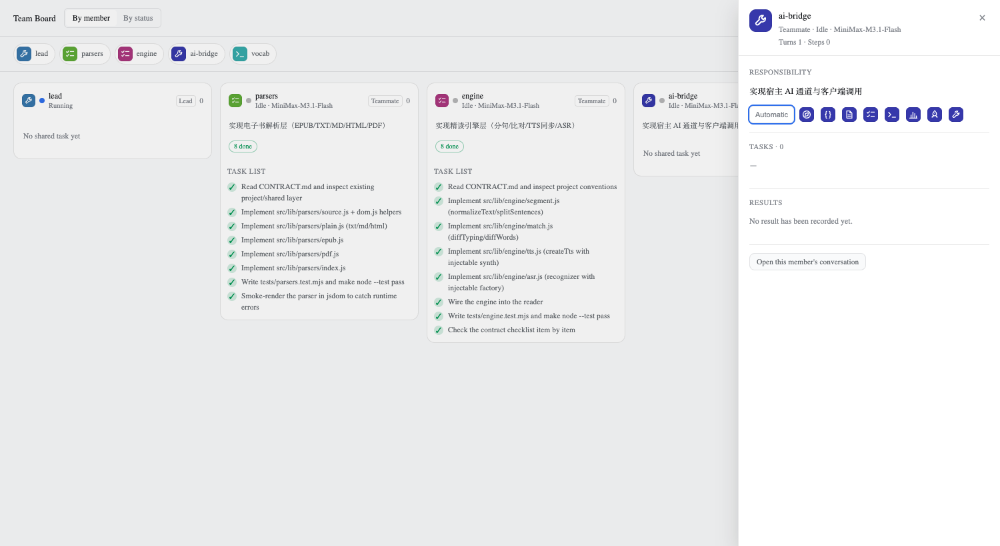

# Agent Team Board for DeepSeek Harness

Watch an Agent Team work. The board adds a **Team Board** tab next to
**Trajectory** in the conversation header, and shows how the team is
cooperating right now: one column per teammate, that teammate's shared tasks
as cards, and what the work actually cost.


```
┌ conversation ──────────────────┬ team board ───────────────────────────┐
│ agent / user turn              │  By member            [ By status ]   │
│                                │  ─────────────────────────────────────  │
│                                │  ┌ parsers ─┐ ┌ engine ──┐ ┌ qa ──┐   │
│                                │  │ ● 8 done │ │ ● 5 done │ │ idle │   │
│                                │  │ ✓ task   │ │ ✓ task   │ │      │   │
│                                │  │ ✓ task   │ │ … task   │ │      │   │
│                                │  └──────────┘ └──────────┘ └──────┘   │
└────────────────────────────────┴──────────────────────────────────────┘
```

## What you get

| | |
| --- | --- |
| **A column per teammate** | live state (running / idle / provisioning / failed), role, model, and the responsibility the member was created with |
| **Two layouts, one dataset** | **By member** shows who is carrying the work; **By status** groups the same work into pending / in progress / done |
| **Shared tasks as cards** | subject, status, readiness, owner, dependencies, touched files, and write-scope conflicts |
| **A member panel** | click an avatar: the full assignment brief, the member's tasks, its token usage, its results and the files it actually wrote |
| **Artifacts, not promises** | the files a member really wrote, read from its own session log — not the scope a task declared |
| **Token cost** | the same counters the host sums, with the cache hit rate and the time the member spent |

## Install

```bash
git clone https://github.com/colsonSung/dsh-agent-team-board.git
cd dsh-agent-team-board
./install.sh              # installs into the profile of the running Harness
```

`install.sh` takes an optional profile name (`./install.sh web`) and is
idempotent. It installs the package into the profile and adds the bundle row
to `<profile>/cordis.patch.yml`. **Restart the Harness afterwards** — the
host half of a plugin is loaded at start-up.

Manual equivalent:

```bash
dsh plugin --profile web add ./plugin
```

```yaml
# <profile>/cordis.patch.yml
- insert:
    - id: agent-team-board
      name: 'dsh-agent-team-board'
```

After the restart the **Team Board** tab sits next to **Trajectory**. It shows
a notice on sessions that have no agent team, so it is safe to leave open.

## What it shows

| Area | Content |
| --- | --- |
| Summary bar | Member count, task count (both kinds of work), in-progress count, the team's token total, and the layout switch |
| Roster strip | One avatar and name per member, in **both** layouts; clicking an avatar opens that member's panel |
| Member column | Live state, role, model, the member's responsibility, its work split by status, and what the work cost |
| Lead duty | The Lead is never in the catalog, so it carries a duty of its own — "Leads the team — N members", or "Working on its own" |
| Status pills | The member's three counts — pending, in progress, done — always shown, so an empty bucket is visible too |
| Status group | One group per status: the shared tasks the member owns as cards, and the steps it recorded as rows |
| Task card | Subject, status, readiness, owner, dependencies, touched files, and write-scope conflicts |
| Unassigned column | Tasks nobody has claimed yet |

**A column is the agent's work, not the shared board.** Each member column
carries the member's work split by status: its *shared tasks* as full cards,
and its *own steps* as rows. The first comes from the Lead's `agentTeam`
projection, the second from the member's own `todos` projection — so a team
that never used the shared task tools still shows every member's work.

Switching layouts never hides work that the other layout shows. A team with
thirty finished steps and one shared task shows "Done 30" and "Pending 1" in
the status view, not an empty board.


## The member panel

Clicking an avatar opens a panel that answers the two questions a team lead
actually asks: *what is this member responsible for*, and *what did they
produce*.

| Section | Source |
| --- | --- |
| Responsibility | The Lead's `subagentCatalog` label — the job description the member was created with |
| Full brief | The member's own assignment brief, collapsed by default |
| Tasks | The member's shared tasks from the team projection |
| Token usage | The total, the three buckets, the cache hit rate, and the time it spent |
| Artifacts | The files the member actually wrote, read from its own session log; click one to open it in the sidebar |
| Results | The member's own completed steps: each file they wrote and each check they ran |
| Files touched | The paths the tasks declare, clickable into the right sidebar |
| Workload | The member's turns and steps |



The panel is read-only. It opens on a click, closes on Escape or a click
outside it, and never performs a Team RPC of its own.

## How it works

The board registers on the `conversation.view` slot — the same tab row that
carries Chat and Trajectory — with `order: 15`, so it lands to the right of
Trajectory without touching the host shell:

```js
ctx.slots.inject('conversation.view', () => ctx.slots.register({
  name: 'conversation.view',
  id: 'agent-team-board',
  order: 15,
  locale: NS,
  label: () => t('view.label'),
}, (props) => h(TeamBoardView, { ctx, ...props })));
```

Its data comes from the Lead session's `agentTeam` projection in the shared
session store. Host projection frames keep that value current, so the board
refreshes itself while a turn runs and performs **no Team RPC of its own**.
Everything else is local: own artwork, own cards, and host theme tokens only.
The plugin imports no other Harness client package.

The full technical description — the data flow, the token arithmetic, the
artifact reading, the limitations — is in [`plugin/README.md`](plugin/README.md).

## Preview harness

The board can be rendered without a running Harness. The preview harness
mounts the real component with mock team data and an approximated host
palette, which makes layout regressions visible:

```bash
cd plugin/tools/preview
node build.mjs            # → preview.bundle.js
playwright screenshot --channel chrome --viewport-size 1800,520 \
  "file://$PWD/index.html" /tmp/board.png
```

## Build and test

```bash
cd plugin
pnpm install
node build.mjs                 # → client.js
node --test tests/*.mjs        # 21 passing
```

`client.js` is the shipped browser bundle and is committed, so a clone
installs without a build step. The build is only needed after editing
`plugin/src/`.

## Repository layout

```
plugin/              the DeepSeek Harness bundle
  src/               the browser half: locale, stylesheet, the View and its components
  tests/             jsdom smoke tests over the built bundle
  tools/preview/     a standalone harness that renders the board with mock data
  build.mjs          esbuild → client.js in the shell's module-loader envelope
docs/                screenshots
install.sh           installs the bundle into a profile
```

## Notes for contributors

* The bundle id must equal the package name: the shell's module loader keys
  the registered factory by that id, and the bundle row in the profile patch
  resolves the package by the same name. `plugin/build.mjs` reads the name
  from `plugin/package.json`, and the test suite asserts the two agree.
* The plugin has **no runtime dependencies**. React comes from the Harness
  shell's module table; a second copy would break the hooks.

## License

[MIT](LICENSE) © 2026 Ethan Song
