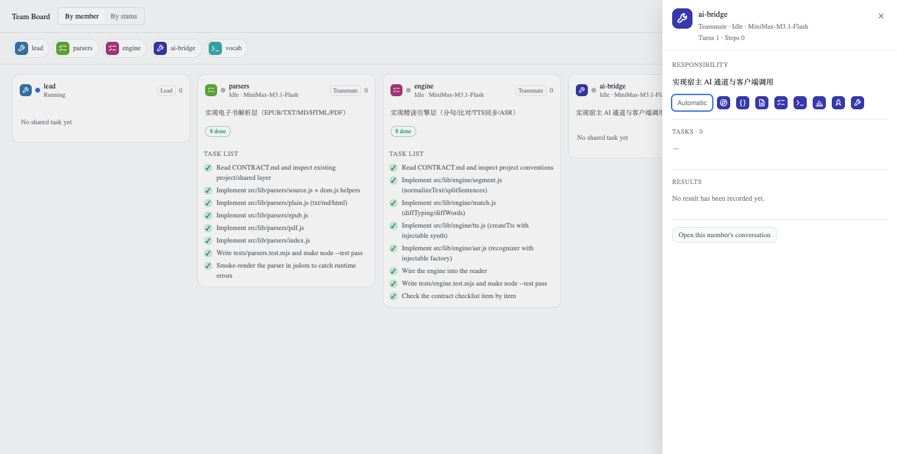
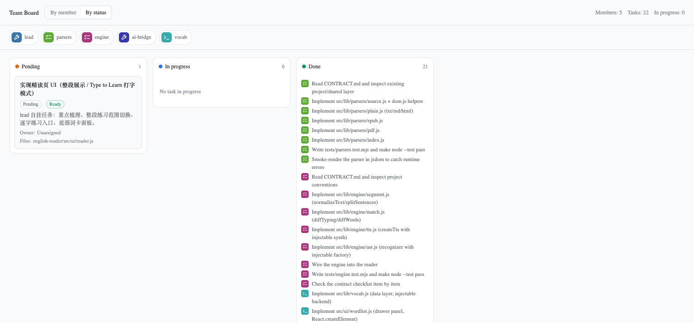
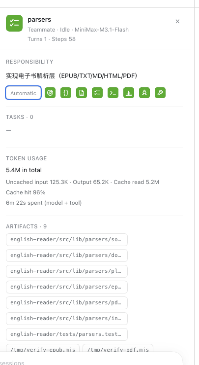
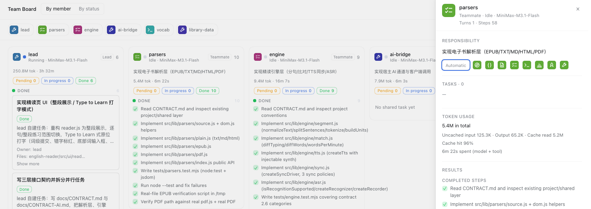

# Agent Team Board

A **Team Board** tab for the DeepSeek Harness, placed directly to the right of
**Trajectory** in the conversation header. It shows how an Agent Team is
cooperating right now: one column per teammate, with that teammate's shared
tasks as cards.



## What it shows

| Area | Content |
| --- | --- |
| Summary bar | Member count, task count (both kinds of work), in-progress count, the team's token total, and a layout switch |
| Roster strip | One avatar and name per member, on screen in **both** layouts; clicking an avatar opens that member's panel |
| Member column | Live state (running / idle / provisioning / failed), role, model, **the member's responsibility**, **its work split by status**, and **what its work cost** |
| Lead duty | The Lead is never in the catalog, so it carries a duty of its own — "Leads the team — N members", or "Working on its own" when it is alone |
| Status pills | The member's three counts — pending, in progress, done — always shown, so an empty bucket is visible too |
| Status group | One group per status: the shared tasks the member owns as cards, and the steps it recorded as rows |
| Task card | A shared task: subject, status, readiness, owner, dependencies, touched files, and write-scope conflicts |
| Unassigned column | Tasks nobody has claimed yet |
| Status icon | Every state is **drawn, not typed**: an empty ring for work not started, a ring with a solid core for work in progress, a soft disc with a check for work that is done. The same icon rides in a shared task's status pill |
| Halo | A column that carries work in progress wears an animated halo, so the board says where the work is without being read |

The second layout groups **the same work** by status (pending / in progress /
done): the shared tasks as full cards, and every member's task items as rows
carrying their owner's avatar. Switching layouts therefore never hides work
that the other layout shows — a team with thirty finished steps and one
shared task shows "Done 30" and "Pending 1" in the status view, not an empty
board.



**A column is the agent's work, not the shared board.** Each member column
carries the member's work split by status — pending, in progress, done — with
three counts above the list:

* the member's **shared tasks**, as full cards, in the group of their status;
* the member's **own steps**, as rows, in the group of their status.

The first comes from the Lead's `agentTeam` projection. The second comes from
the member's own `todos` projection, so a team that never used the shared task
tools still shows every member's work. A group without work is not rendered:
the counts above it already say it is empty.

The status layout says so outright when there is nothing to group: each
column names its own emptiness ("no pending task"), and the board explains that
this team does not use the shared task board and points back to the member
layout. It never presents three empty columns as if they were a backlog.

The roster strip is what keeps the member panel reachable. The panel is the
only place a member's responsibility and results appear, and the status
layout renders no member column — so without the strip the panel would be
unreachable in half the board.

## The complete task record

A member's `todos` projection carries **the round that is running**. A new
round starts with an empty list, so the work of the earlier rounds disappears
from it — a Lead that finished three rounds ago shows an empty column even
though it recorded seventeen items along the way.

The board therefore asks the Host for the whole record. The Host reads the
Session log, keeps only the `todo/write` events, and merges them: an item
counts once, and the last write that mentioned it decides its status. The
browser receives a few kilobytes instead of the log, and the column shows the
whole record — with the running round's own list merged in, so an item both
rounds mention is counted once and the running round wins its status.

| Where | What |
| --- | --- |
| `GET /api/agent-team-board/history?sessionId=…` | The Host half's route: one Session's complete task record |
| Column counts | Pending / in progress / done over the **complete** record, not the running round's slice |
| Column note | "N from earlier rounds" under the counts, so the two sources stay distinguishable |
| List | The newest eight entries of a group stay on screen; the rest fold behind "Show N more" |
| Member panel | The same complete record, with the same fold |

The Host reads the log on demand and caches the answer for fifteen seconds, so
re-opening the board costs one small request per member.

## The halo

A column that carries work in progress wears a halo: a soft breathing glow
under it, and a light that runs around its edge. The travelling light is a
conic gradient whose angle is animated, so the ring keeps the shape of the
column instead of turning with it.

The rule is **record-based**, exactly like the status counts above it, and it
counts both kinds of work:

* a shared task the member owns carries the `in_progress` status;
* a step the member recorded itself carries the `in_progress` status.

A member whose session is running but that registered no work wears no halo —
it is marked as running in the column header, not as an in-progress item. In
the status layout only the in-progress column wears one, and only while it
holds something.

The halo is decorative, so it follows the reader's motion preference: with
`prefers-reduced-motion: reduce` the animation stops and the column keeps
its tinted edge.

## Avatars

The Harness has no avatar concept for agents, so the board owns its own:

* Every member gets a glyph chosen from an original eight-glyph set, with a
  colour derived from their name. The same member always looks the same.
* Clicking an avatar opens the member panel, where the glyph can be replaced.
  The choice is stored per member name in the browser's own storage, so it
  survives a reload and follows the member wherever the team appears.
* Clicking the member's *name* opens their conversation instead.

## The member panel


Clicking an avatar opens a panel that answers the two questions a team lead
actually asks: *what is this member responsible for*, and *what did they
produce*.

| Section | Source |
| --- | --- |
| Responsibility | The Lead's `subagentCatalog` label — the job description the member was created with |
| Full brief | The member's own assignment brief (`titleInput.first.text`), collapsed by default |
| Tasks | The member's shared tasks from the team projection |
| Token usage | The member's `tokenUsage` projection: the total, the three buckets, the cache hit rate, and the time it spent |
| Artifacts | The files the member actually wrote, read from its own session log; click one to open it in the sidebar |
| Results | The member's own completed steps (`todos`): each file they wrote and each check they ran |
| Files touched | The paths the tasks declare, clickable into the right sidebar |
| Workload | The member's turns and steps (`sessionStats`) |

The panel is read-only. It opens on a click, closes on Escape or a click
outside it, and never performs a Team RPC of its own.

## Artifacts

The shared task board only declares a *scope*; the panel lists what really
landed on disk. The artifacts are read from the member's **own session log** —
every `write`, `edit` and `present` tool call — so they are the files that
exist, not the ones somebody promised to make.



Each path is relative to the directory the member worked in, and clicking it
opens the file in the right sidebar.

Two things to know about this list:

* It is the member's **whole session**, not one task. The host reports token
  totals per session, and the file list is read the same way.
* A file created by a shell command (`bash`) does not show up. Only the file
  tools are read, because a shell command's output path cannot be known
  without parsing the command.

## Token usage

What a member's work cost is shown next to the work itself: the column
carries `15.5M tok · 6m 19s`, and the panel breaks the number down.



The counters are the host's own, so the board and the host's subagent list
never disagree:

| Number | Source |
| --- | --- |
| Total tokens | `uncachedInput + output + cacheRead + cacheWrite` — the same four buckets the host sums |
| Uncached input | Tokens sent to the model without a cache hit |
| Output | Tokens the model produced |
| Cache read | Tokens read back from the prompt cache |
| Cache hit | `cacheRead / total` |
| Time | `sessionStats.llmMs + sessionStats.toolMs`, the model's own time plus the tools' |

A member that keeps no task list of its own shows no *Results*, but its
**Artifacts** still list every file it wrote — the two sections answer
different questions, and together they cover a member that never used the
todo tool.

One caveat worth knowing: the **Lead's own column is usually the largest**,
because the Lead re-reads the whole conversation on every step. A team total
is therefore mostly the Lead's context, not the team's work.

## How it works

The board registers on the `conversation.view` slot — the same tab row that
carries Chat and Trajectory — with `order: 15`, so it lands to the right of
Trajectory without touching the host shell:

```js
ctx.slots.inject('conversation.view', () => ctx.slots.register({
  name: 'conversation.view',
  id: 'agent-team-board',
  order: 15,
  locale: NS,
  label: () => t('view.label'),
}, (props) => h(TeamBoardView, { ctx, ...props })));
```

Its data comes from the Lead Session's `agentTeam` projection in the shared
Session store (`projectionsBySession[lead].values.agentTeam`). Host projection
frames keep that value current, so the board refreshes itself while a turn runs
and performs **no Team RPC of its own**. The projection carries the roster
(`members`), the shared task board (`tasks`), and the durable-record failure
notice (`failure`).

A teammate conversation reports its Lead through the subagent address, so the
board always reads the Lead's roster:

```js
const leadSessionId = useSession((snapshot) => snapshot.subagent?.address.parentSessionId) ?? sessionId;
const team = useSessions((state) => state.projectionsBySession[leadSessionId]?.values.agentTeam);
```

Clicking a member's name opens that member's conversation through the
`uiWorkspace` service, using the same addressed-subagent path the host's own
Agent Teams panel uses. The member's own records come from the same shared
store: the Lead's `subagentCatalog` carries the responsibility each member was
created with, and the member's own session carries the brief, the completed
steps and the session statistics:

```js
const duty = useSessions((state) => state.projectionsBySession[leadSessionId]?.values.subagentCatalog
  ?.find((child) => child.id === selectedId)?.label);
const steps = useSessions((state) => state.byId[selectedId]?.projectionValues?.todos);
```

Everything else is local: own artwork, own cards, and host theme tokens only.
The plugin imports no other Harness Client package.

## Layout

```
src/client-entry.js     the browser half: locale, stylesheet, the View and its components
src/avatars.js          the original glyph set, the colour rule, and the Avatar component
tests/board.client.test.mjs  jsdom smoke tests over the built bundle
tools/preview/          a standalone harness that renders the board with mock data
build.mjs               esbuild → client.js in the shell's module-loader envelope
```

## Build and test

```bash
node build.mjs                 # → client.js
node --test tests/*.mjs        # 24 passing
node tools/preview/build.mjs   # → tools/preview/preview.bundle.js
```

The preview harness renders the board with mock Team data and an approximated
host palette, which makes layout regressions visible without a running
Harness:

```bash
cd tools/preview
playwright screenshot --channel chrome --viewport-size 1800,520 \
  "file://$PWD/index.html" /tmp/board.png
```

## Install

The plugin is a client bundle, so the Host half is inert:

```yaml
# package.json of the DSH profile
"dependencies": {
  "@local/agent-team-board": "link:/path/to/agent-team-board"
},
"dsh": {
  "profile": {
    "bundles": ["@local/agent-team-board"]
  }
}
```

After the profile recomposes, the tab appears next to Trajectory. Rebuilding
`client.js` swaps the plugin in open pages without a reload; the host watches
the bundle artifact for changes.

## Limitations

* The board shows the **shared task board** and each member's **own todo
  list**, not a session's private scratchpad. A member that called neither
  tool shows no work even when its conversation is full of it.
* The todo list is read **across every round** of a Session, so the counts
  cover the whole record rather than the round that is running. The Host
  answers from the Session log, so a member whose log cannot be read falls
  back to the projection it already holds and says so under the counts.
* The status counts are **record-based**: "in progress" means a task or a step
  carries that status. A member whose session is running but that registered
  no work is shown as running in the column header, not as an in-progress
  item. The halo follows the same rule.
* The member panel's *results* are the member's own recorded steps — what it
  reported as done, across all of its rounds. A member that never kept a todo
  list shows no steps, even when its conversation is full of work.
* A member's *files touched* are the paths its tasks declare, not a diff of
  what it wrote.
* The token counts are **cumulative for the session**, not per task. A shared
  task cannot be billed to a member on its own, because the host only reports
  the session's totals.
* The artifacts come from the **file tools**, so a file a shell command
  created is not listed. A member that only ran shell commands shows no
  artifacts.
* Write-scope overlaps are advisory: the host reports them, and the board
  surfaces them, but nothing is blocked.
* The board is read-only. Tasks are created and updated by the team agents
  through their tools.
* Avatar choices live in the browser's own storage, so they follow the
  browser, not the account.
